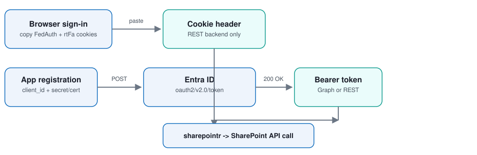
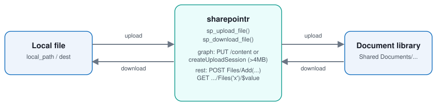
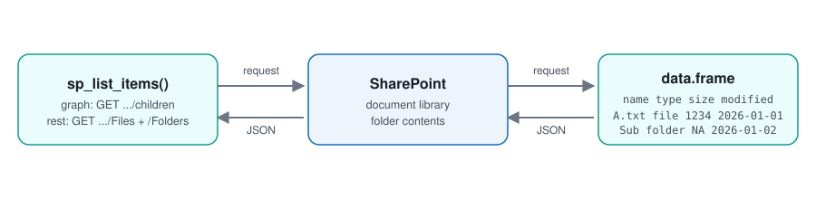
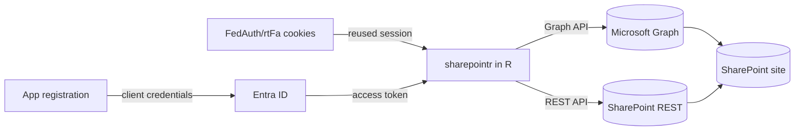

<p align="center">
  
</p>

<p align="center">
  Upload, download, list, and manage files on SharePoint from R.
</p>

<p align="center">
  <a href="https://github.com/esbeneickhardt/sharepointr/actions/workflows/R-CMD-check.yaml"></a>
  
</p>

<p align="center">
  <a href="#quick-start">Quick Start</a> · <a href="#authentication">Authentication</a> · <a href="#how-it-works">How it works</a> · <a href="#functions">Functions</a> · <a href="#notes">Notes</a>
</p>

<div align="center">
<table>
<tr>
  <td align="center"><br/><sub>Authentication</sub></td>
  <td align="center"><br/><sub>Upload / download</sub></td>
</tr>
</table>
<br/><sub>Listing files and folders</sub>
</div>

## Quick Start

```r
install.packages("pak")
pak::pak("esbeneickhardt/sharepointr")
```

The fastest way to get going needs no app registration or admin — just your
own SharePoint access. Sign in to SharePoint in a browser, then copy the
`FedAuth` and `rtFa` cookie values (dev tools → Application/Storage →
Cookies):

```r
library(sharepointr)

auth <- sharepoint_auth(
  site_url = "https://contoso.sharepoint.com/sites/MySite",
  fedauth  = Sys.getenv("SHAREPOINT_FEDAUTH"),
  rtfa     = Sys.getenv("SHAREPOINT_RTFA")
)

sp_list_items(auth, "Shared Documents")
sp_upload_file(auth, "report.xlsx", "Shared Documents/Reports/report.xlsx")
sp_download_file(auth, "Shared Documents/Reports/report.xlsx", "report.xlsx")
```

Build the `auth` object once per session; every other function reuses it.
For unattended scripts, see [Authentication](#authentication) below for the
app-registration-based alternative.

## Authentication

`sharepoint_auth()` supports three methods:

| Method | Setup | Needs admin? | Works unattended? | Backend |
|---|---|---|---|---|
| **Cookie** (`fedauth`/`rtfa`) | Copy two cookie values from your browser | No | No — cookies expire on your tenant's sign-in schedule and need re-copying | REST only |
| **Client secret** | Register an app in Entra ID, create a secret | Yes (one-time consent) | Yes | Graph or REST |
| **Certificate** | Register an app in Entra ID, upload a cert | Yes (one-time consent) | Yes | Graph or REST |

Use cookie auth for interactive, one-off, or personal scripts. Use a client
secret or certificate for scheduled jobs, pipelines, or anything that needs
to run without you.

```r
# Client secret
auth <- sharepoint_auth(
  site_url      = "https://contoso.sharepoint.com/sites/MySite",
  tenant_id     = "contoso.onmicrosoft.com",
  client_id     = Sys.getenv("SHAREPOINT_CLIENT_ID"),
  client_secret = Sys.getenv("SHAREPOINT_CLIENT_SECRET")
)
```

Setting up the app registration (client secret/certificate only) takes a
few minutes:

1. In the [Entra admin center](https://entra.microsoft.com), go to
   **App registrations → New registration**. Any name works.
2. Under **Certificates & secrets**, create a **client secret** (or upload a
   certificate's public key).
3. Under **API permissions**, add an **Application permission**: Microsoft
   Graph → `Sites.Selected` (scoped per-site, recommended) or
   `Sites.ReadWrite.All`; or SharePoint → `Sites.FullControl.All` if using
   the REST backend.
4. Click **Grant admin consent**.
5. If you used `Sites.Selected`, also grant the app access to your specific
   site via the [Graph site permissions API](https://learn.microsoft.com/graph/api/site-post-permissions)
   or PnP PowerShell — otherwise every call 403s.

Full walkthrough: `vignette("sharepointr")`.

## How it works



Cookie auth always uses the REST API. Client secret/certificate auth
defaults to Microsoft Graph (handles files over 4MB with a chunked,
resumable upload session automatically) or can target the REST API instead
with `backend = "rest"`.

## Functions

| Function | Purpose |
|---|---|
| `sharepoint_auth()` | Build an auth object (do this once) |
| `sp_list_items()` | List files and folders in a path |
| `sp_list_files()` / `sp_list_folders()` | Filtered variants of the above |
| `sp_download_file()` | Download a file |
| `sp_upload_file()` | Upload a file (chunked automatically if large, on the Graph backend) |
| `sp_delete_item()` | Delete a file or folder (moved to the site recycle bin) |
| `sp_create_folder()` | Create a folder |
| `sp_file_exists()` | Check whether a file exists |

Every function takes an `auth` object first and a library-relative `path`
second, e.g. `"Shared Documents/Reports/2026/Sales.xlsx"`.

## Notes

- Deleted items go to the site recycle bin, not permanently deleted.
- Paths are library-relative, e.g. `"Shared Documents/Reports"`, not full
  URLs — `sharepointr` resolves the site and (on the Graph backend) the
  matching drive for you.
- Cookie authentication is unofficial — it isn't a documented Microsoft
  API, just a reuse of your browser's session cookies. It can stop working
  if your tenant's Conditional Access policies change.
- Tests run entirely against mocked HTTP responses — no live SharePoint
  tenant is required to run `R CMD check` or the test suite.

## License

MIT © Esben Eickhardt
